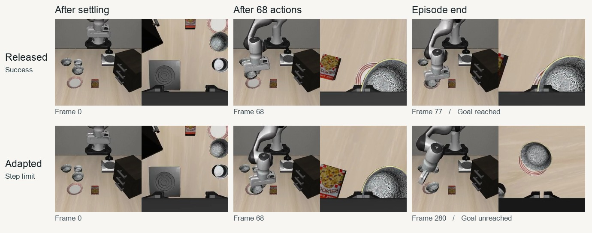

# SmolVLA on LIBERO-Spatial

A two-step SmolVLA student completed **70 of 100 placements**, matching its ten-step teacher’s success count on the same 100 LIBERO-Spatial starts. Reducing the solver from ten to two Euler updates brought median action-chunk latency from **382 to 201 ms** on one RTX 4090. With the original teacher weights, the two-step solver completed **68/100**.

| Policy in the same evaluation | Euler steps | Successful placements | Median ms/chunk | P95 ms/chunk |
| --- | ---: | ---: | ---: | ---: |
| Fine-tuned teacher | 10 | 70/100 | 381.7 | 427.8 |
| Same teacher weights, shorter solver | 2 | 68/100 | 200.8 | 209.1 |
| Distilled student | 2 | **70/100** | **201.0** | 208.0 |

Each policy observes a language instruction, external and wrist camera images, and robot state. It generates 50 end-effector and gripper commands at a time. The table times that prediction at batch size one. The robot executes up to 50 commands at 20 Hz before requesting a new prediction. All ten instructions were present in training. [Per-task results, paired gains and losses, and rollout videos](results/few-steps/README.md)

## Training the teacher and student

The teacher starts from LeRobot’s robot-pretrained SmolVLA. Fine-tuning on Spatial demonstrations freezes the vision-language backbone and updates the action expert and its input/output projections, including the state projection. The 25,000-update checkpoint won selection on 30 development starts. On the separate 100-start evaluation it completed **70** placements, compared with **0** for the original base and **66** for LeRobot’s released LIBERO policy. [Training and checkpoint selection](results/training/README.md) · [Base and released-policy evaluation](results/evaluation/README.md)

An initial sweep of 10, 5, 2 and 1 Euler steps exposed a loss of placements at short solver lengths. For distillation, the teacher and student receive the same observation and initial action noise. The student learns to reach the teacher’s midpoint in its first update and its endpoint in its second. On the final starts the student gained eight placements and lost six against the direct two-step baseline. [Distillation implementation](scripts/distill_two_steps.py) · [Episode-level evidence](results/few-steps/episodes.jsonl)

## Watch the policy execute

The adapted policy picked up the bowl from the center of the table and placed it on the plate in **100 actions**. In the paired example below, both policies lifted the target. The released policy completed the placement in 79 actions and the adapted policy timed out. [Successful adapted rollout](results/evaluation/task-02_state-02_adapted.mp4) · [Paired videos and measured trajectories](results/evaluation/placement-case/README.md)



## Reproduce the results

This command uses Python 3.12’s standard library to verify checkpoint selection, 300 adaptation/control rollouts and 510 few-step rollouts. It recomputes the reported success counts, paired outcomes and inference latencies from episode records.

```bash
python3 scripts/results.py
```

The GPU guide covers data preparation, fine-tuning, the native solver sweep, distillation and closed-loop evaluation. The repository ships the recipes, checkpoint digests and compact evidence. Running the training commands produces loadable teacher and student weights under `outputs/`. [GPU reproduction guide](docs/reproduce.md) · [Observation and action conventions](docs/interface.md)

## Credits and license

The project implements the demonstration split, single-GPU adaptation and matched evaluation using the SmolVLA policy and processors from LeRobot, and the tasks, demonstrations and success predicates from LIBERO. [SmolVLA paper](https://arxiv.org/abs/2506.01844) · [LeRobot](https://github.com/huggingface/lerobot) · [LIBERO](https://github.com/Lifelong-Robot-Learning/LIBERO)

The MIT license covers original project code and documentation. Upstream software, model weights, demonstrations and scene assets retain their respective licenses. [License](LICENSE)
