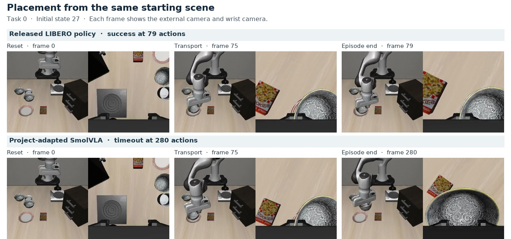

# Both policies lifted the target bowl. One completed the placement.

In LIBERO-Spatial task 0, the instruction identifies the black bowl between the plate and the ramekin. On initial state 27, both policies made two-sided contact with the requested bowl and lifted it. The released policy satisfied the placement predicate after 79 actions. The 25,000-update project policy ran for 280 actions and timed out. The shared seed was 1027, and the saved simulator states immediately after settling had the same SHA-256 digest. [Released video](released.mp4) · [Adapted video](adapted.mp4) · [Frame-by-frame measurements](trace.csv)

| Observation | Released checkpoint | Project-trained checkpoint |
| --- | ---: | ---: |
| First sampled two-pad contact on target | Frame 61 | Frame 59 |
| First target lift of at least 3 cm during contact | Frame 61 | Frame 59 |
| Greatest rise during contact | 10.00 cm | 11.38 cm |
| Bowl–plate horizontal separation at frame 75 | 2.76 cm | 4.86 cm |
| Bowl–plate horizontal separation at termination | 1.83 cm | 7.01 cm |
| Last sampled two-pad contact with target | Frame 79 | Frame 84 |

At frame 75 the target was still between the fingerpads in both rollouts. Its center was 3.82 cm above its initial height under the released policy and 6.23 cm above it under the adapted policy. Four actions later, the released policy completed the placement. Under the adapted policy, the last measured two-pad contact occurred at frame 84 and the run ended with the bowl center 7.01 cm from the plate center in the table plane.

LIBERO evaluates success with its bowl-on-plate predicate. The distances describe the trajectories. Across the 100 project-policy rollouts, seven ended unsuccessfully after a lift of at least 3 cm during sampled two-pad contact. [Failure counts and evaluation protocol](../README.md)
