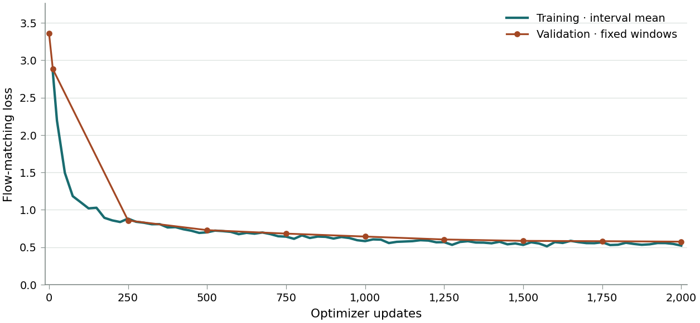

# Adapting SmolVLA on a single RTX 4090

The training run initialized the full policy from `lerobot/smolvla_base`. It froze the vision-language backbone and updated the action expert and the projections for robot state, actions and flow time. The LIBERO interface uses two cameras, an eight-value state and seven-dimensional relative actions. SmolVLA pads the numeric inputs internally, so the base tensors load with their original shapes. [Model construction and training loop](../../scripts/train.py) · [Base weights](https://huggingface.co/lerobot/smolvla_base/tree/5e8d12a6e2975b0e5e5fce7c8caf47c371d257b6)

## Demonstrations

The ten Spatial instructions select **432 complete demonstrations** from the pinned LeRobot LIBERO dataset. Dataset task IDs and simulator task IDs use different orderings. The preparation script matches instructions and splits episodes within each task. It fits the state and action normalization on the **47,630 frames from 389 training episodes**. The other **43 episodes, with 5,340 frames**, supply validation samples. [Episode IDs, task mapping and normalization statistics](spatial_split.json) · [Data preparation](../../scripts/prepare_training.py)

Each sampled observation supplies its language instruction, two images, robot state and up to 50 consecutive action targets. The loss masks actions beyond the end of the episode. Validation uses eight fixed observation windows per task, fixed noise and fixed time sampling. This measures imitation loss on familiar instructions. [Training configuration](../../configs/spatial_train.json)

## Recorded run

| Measurement | Value |
| --- | ---: |
| Updates × batch size | 2,000 × 8 |
| Trainable / total parameters | 99,880,992 / 450,046,176 |
| Fixed-window validation loss, initial → final | 3.3575 → 0.5740 |
| Optimizer loop time | 291.31 s |
| Peak PyTorch GPU memory in that loop | 2.77 GiB allocated, 2.82 GiB reserved |

Training used AdamW, BF16 autocast, gradient clipping at 10, a 100-update warm-up and cosine decay from a peak learning rate of 0.0001. The reported time covers the optimizer updates and the wait for training batches. [Training and validation history](training_history.json)

The checkpoint verification found all 345 vision-language backbone tensors bitwise identical to their base values. Both state-projection tensors, all eight action and time projection tensors, and 112 of 145 action-expert tensors changed. The exported processors matched the training-split statistics. The trained model can be regenerated with the documented recipe. [Recorded checkpoint digest and tensor comparison](checkpoint.json) · [Reproduction commands](../../docs/reproduce.md) · [Closed-loop results](../evaluation/README.md)
